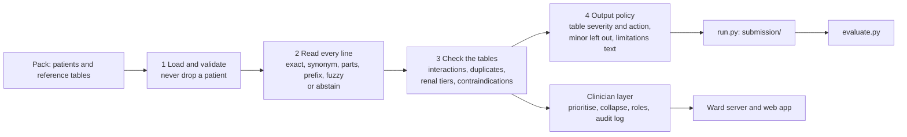

# Medsafe: a second pair of eyes on the medication list

**H4, TalentAP Mega Hackathon 2026 · Team 1058**

Medsafe reads a patient's consolidated medication list exactly as the ward nurse wrote it, resolves every line to its generic names (brands, misspellings, abbreviations, combination brands), and flags drug interactions, duplicate therapy, kidney-dose problems and drug-condition contraindications from the pack's reference tables. Every alert carries the table's severity, a concrete action for the prescriber, a confidence and its limitations. **A clinician decides**: the system never calls a list safe, only that no issue was found in what it saw.

| | |
|---|---|
| **Submission** | `submission/H4_predictions.csv` (5,759 alerts) and `submission/H4_resolution.csv` (20,867 lines), for all 3,500 test patients |
| **Made by** | `python run.py --split test --output ../submission`, from `FULL_CODE/` ([how to run](#how-to-run)). Re-running it writes the same files byte for byte |
| **Detection** | Deterministic rules over the pack's tables. No language model and no trained model in it; no network ([why](#ai-usage-rule-12)) |
| **Holdout score** | **1.000** with the organisers' `evaluate.py`; near-miss recall **22 / 22**; misspelled names **1.000** ([results](#results), and why they are optimistic) |
| **Demo** | A ward app where a nurse, lab technician, pharmacist and prescriber take one patient from admission to decision ([demo](#the-demo-app)) |

## What is in this zip

```
1058_H4.zip
├── README.md               this file
├── .gitignore
├── submission/
│   ├── H4_predictions.csv  one row per alert
│   └── H4_resolution.csv   one row per written medication line
└── FULL_CODE/              all the code: the pipeline that wrote submission/, the evaluation harness,
                            the trained-model experiments, the ward server and the web app
```

The zip is built from a fresh `git clone` by `FULL_CODE/tools/make_submission.py`, which reruns the pipeline, validates its output and refuses to build if it differs from the committed `submission/`. On GitHub (https://github.com/PavanSuryaChintada/h4-hosp-patient) the contents of `FULL_CODE/` sit at the repository root.

## Results

Scored by the organisers' unmodified `evaluate.py`. The test labels are hidden, so the 1,500 training patients are split by patient into **dev** (1,200, used to build the rules) and **holdout** (300, never used for tuning). Every number below comes from `python -m eval.run`.

| | Dev | Holdout | Organisers' baseline, holdout | Standard EHR-style check, holdout |
|---|---|---|---|---|
| **Primary score** | **1.000** | **1.000** | 0.402 | 0.114 |
| Serious recall | 1.000 | 1.000 | 0.277 | 0.230 |
| **Near-miss recall** | **68 / 68** | **22 / 22** | 0 | 0 |
| **Resolution accuracy, misspelled entries** | **0.999** | **1.000** | 0.000 | 0.000 |
| Resolution accuracy, all entries | 0.9999 | 1.000 | 0.769 | 0.618 |
| Precision | 1.000 | 1.000 | 0.951 | 0.378 |
| Graded recall (exact severity) | 1.000 | 1.000 | 0.340 | 0.227 |
| Noise alerts per patient | 0.00 | 0.00 | 0.08 | 1.17 |

On holdout every one of the 746 labelled issues is matched, at the right severity, with no false alert: 457 interactions, 107 duplicate therapies, 130 renal-dose issues and 52 contraindications. The standard EHR-style check is our reproduction of a typical hospital check over the same tables (`FULL_CODE/tools/ehr_reference.py`): exact formulary names only, every listed pair at the table's severity, one flat kidney warning per drug.

**Read these as optimistic for the hidden test set.** The resolver's synonym list and the condition vocabulary were built by reading all the training text, holdout included (`FULL_CODE/docs/DECISIONS.md`, D-014 and D-025). On the 3,500 test patients the score will be lower, mostly from misspellings that no training line contains. When the resolver cannot tell two names apart it marks the line "verify manually" rather than guess.

**The test submission:** 5,759 alerts on 3,500 patients (180 contraindicated, 2,174 major, 3,405 moderate) and one resolution row for each of the 20,867 written lines. Minor issues are left out on purpose: each one costs 0.25 noise and a prescriber gains little from it, so the app shows them last instead. Besides the six required columns, every alert row carries a `confidence_and_limitations` text: how surely the names were read, the rule and table behind the alert, what could not be checked for that patient, and that a clinician decides. The organisers' validators accept the file as it is.


## How to run

Tested on Windows 10 with Python 3.11.9; the web app needs Node 20 or later. Run everything from `FULL_CODE/`.

**1. Install.** The pipeline needs only `rapidfuzz`.

```bash
cd FULL_CODE
python -m venv .venv
.venv\Scripts\activate                 # Windows;  macOS/Linux: source .venv/bin/activate
pip install -r requirements.txt        # rapidfuzz, pytest
pip install -r requirements-dev.txt    # pandas and numpy for the organisers' evaluate.py; matplotlib for the graphs
```

**2. Put the data in place.** The organisers' pack is not in the zip (their rule). Copy the pack folder, the one holding `evaluate.py`, `baseline/` and `data/`, to `FULL_CODE/data/pack/`, so that `FULL_CODE/data/pack/data/patients_test.csv` exists. (Elsewhere works too: pass `--input <pack>/data` to `run.py` and set `MEDSAFE_DATA_DIR=<pack>` for the `eval` commands.) **No model has to be downloaded**: the pipeline uses none, and the three experimental models train from the pack's data with one command (step 4).

**3. Make and check the submission.**

```bash
python run.py --split test --output ../submission    # the two files, every test patient
python -m eval.validate_submission ../submission     # the organisers' own validators, plus every test line present
```

**4. Reproduce every number.**

```bash
python -m eval.run              # dev and holdout scores with evaluate.py -> eval/reports/, docs/evaluation.md
python -m pytest                # 648 tests, about 90 seconds
python -m eval.ml_challenger    # trains the three models on dev, scores them on holdout -> docs/ml-challenger.md
python -m eval.ml_plots         # the graphs in docs/figures/
```

## How it works



1. **Load** (`src/medsafe/data/`). Reads the pack's CSV or JSON, tolerates missing and malformed fields (a missing value stays missing, never 0), and never drops a patient.
2. **Read every line** (`src/medsafe/resolve/`). Strips prefixes, strengths and frequencies (`Tab`, `500mg`, `1-0-1`, `SOS`), then tries an exact brand or generic, a synonym, a combination written as its parts, a prefix, and finally fuzzy matching (rapidfuzz). Combination brands open into their generics. When the best two candidates are too close to call, the line is marked "verify manually" and kept out of the checks instead of guessed. Lines marked stopped and lines that are not medicines are kept on screen but out of the regimen.
3. **Check the tables** (`src/medsafe/rules/`). Every pair in `interactions.csv`; the same generic in two entries (a combination brand plus a single brand counts) and two members of a duplicate-therapy group in different entries; the most restrictive renal tier that the eGFR is below; contraindications read from the diagnosis and allergy text, including negations such as "no h/o" and "ruled out", plus pregnancy letters X and D.
4. **Output policy** (`src/medsafe/output/`). Each alert keeps the table's severity and action word for word, with its confidence and limitations text. Minor issues are not written to the predictions file.

The clinician layer (`src/medsafe/explain/`, `src/medsafe/workflow.py`) orders alerts by severity and, when one drug sits in several serious interactions, leads with "review that drug first", with the chain of interactions it clears shown underneath (a first step towards the optional deprescribing suggestion). It also holds the roles, what each may enter and decide, the override reasons and the append-only audit log.

## AI usage (rule 12)

### No language model in the product, and no trained model in the submission

Nothing in `run.py` or `src/medsafe/` is a language model (an LLM such as GPT, Claude or BioBERT) or a trained model. The submission comes from deterministic rules over the pack's tables and string matching. Nobody, and no model, labelled test patients case by case: the two files are exactly what `run.py` writes. Why rules:

- **The task is defined by rules.** The pack's labels come from a deterministic rule engine over tables it calls complete and authoritative. Rules over the same tables are the direct method, and every alert traces to a rule id and a table row a reviewer can check.
- **A safety check must be reproducible.** Same input, same output, every run. The tests check it, and the zip is only built when a fresh run writes the committed submission byte for byte.
- **Every action is the table's own text.** A language model can invent a drug name, an interaction or a dose. Here every suggested action is the reference table's, word for word.
- **It runs offline.** No API key and no network, so it runs on a district hospital PC and on the grader's machine alike.
- **When unsure, it asks a person.** Two candidate names too close to call become "verify manually", not a guess.

### Three models we trained, measured, and did not ship

To test whether learning would beat the rules, we built three classical machine-learning models (not language models), each written in the Python standard library with no ML framework, each trained only on the dev split and scored once on holdout with `evaluate.py`. Code: `FULL_CODE/eval/ml_challenger.py`, `ml_conditions.py`, `ml_triage.py`; full results: `FULL_CODE/docs/ml-challenger.md`; graphs: `FULL_CODE/docs/figures/`.

| | 1. Reading drug names | 2. Reading conditions and negation | 3. Alert triage |
|---|---|---|---|
| **Method** | Character 3- and 4-gram TF-IDF, nearest neighbour | Logistic regression on the diagnosis and allergy text | Gradient-boosted trees |
| **Trained on** | The reference names and 7,131 labelled dev lines | 2,656 (patient, condition) pairs from dev, 51 present | A standard check's 1,994 alerts on dev patients, 583 worth showing |
| **Tuned by** | 5-fold cross-validation inside dev (accuracy 0.973) | 5-fold cross-validation inside dev (F1 0.75) | Organisers' scorer on 5-fold out-of-fold predictions |
| **Holdout** | Score 0.968; **32 names resolved confidently wrong** (rules: 0); misspelled lines 0.897 | Score 0.962; caught **49% of serious contraindications** (rules: 100%) | Lifted the standard check from 0.114 to 0.347 (noise 1.17 to 0.05, ranking AUC 0.986) |
| **Decision** | Not shipped: a confidently wrong name silently hides a real interaction | Not shipped: it misses half the serious contraindications | Not shipped: it can only hold back alerts a check raised, never add what it missed, and the rules already send no noise |

The models' numbers are out of sample. The rules' holdout numbers are optimistic, as said under [Results](#results), so each row compares how a learned model does on the same patients, not a clean generalisation contest.

### AI tools used to build it

The code, tests and documentation were written with **Claude Code** (Anthropic), an AI coding assistant, working from the team's plans. `FULL_CODE/docs/phases/` holds the build plan, one document per phase, each ending with the prompt that started the work. `FULL_CODE/CLAUDE.md` holds the rules the assistant had to follow:

- no LLM in the detection path
- no network at runtime
- every alert carries its reasons
- never call a patient safe
- abstain rather than guess
- every number comes from a committed script

The team chose the scope, made the design decisions (`FULL_CODE/docs/DECISIONS.md`, 28 of them, each with what it costs if wrong) and checked every result against the test suite and the organisers' scorer.

## Responsible design

| The pack asks for | Where it is |
|---|---|
| "Confidence and limitations" with every alert | The `confidence_and_limitations` column of every prediction row, and every alert card in the app |
| A disclaimer that a clinician decides | In every alert's limitations text and on every patient screen |
| Never claim a list is safe | With nothing found it says "No issue was found in the medicines listed" and "The list may be incomplete". A test fails if the word "safe" appears anywhere in the app's text |
| Clinician-assisting, with a human in the loop and an escalation path | Every alert waits for a person: accept, override with a reason, or defer to the pharmacist. Any role can flag a patient for pharmacist review. Every decision goes to an append-only audit log, and the override patterns show which rules the ward keeps overriding |
| Synthetic data only | All patients come from the pack. The ABHA step in the demo is a labelled sandbox with synthetic records, never connected to ABDM |

## The demo app

**Live (training-set patients, no ward server):** https://pavansuryachintada.github.io/h4-hosp-patient/ and https://h4-hosp-patient.vercel.app

**The full ward, on a laptop:** from `FULL_CODE/`, run `demo.cmd` (Windows) or `./demo.sh` (macOS, Linux). It builds the web app, starts the ward server on an empty ward and opens the sign-in page. By hand: `python tools/export_ui.py`, then `cd ui && npm ci && npm run build && cd ..`, then `python tools/serve_ui.py --open`.

| Role | Email | Password | On the ward |
|---|---|---|---|
| Ward nurse | `nurse@medsafe.demo` | `Nurse@2026` | Admits the patient, fetches records through the ABHA sandbox with consent, types the list as written |
| Lab technician | `lab@medsafe.demo` | `Lab@2026` | Enters eGFR; the kidney-dose rules re-run on it |
| Clinical pharmacist | `pharmacist@medsafe.demo` | `Pharma@2026` | Confirms names the system would not guess; answers alerts handed over |
| Consultant physician | `prescriber@medsafe.demo` | `Medsafe@2026` | Accepts, overrides with a reason, or defers each alert |
| Reviewer | `reviewer@medsafe.demo` | `Review@2026` | Read-only |

These are demo accounts with no real authentication. Who may enter and decide what is `src/medsafe/workflow.py`, enforced by the ward server. Every patient typed in is checked by the same pipeline as `run.py`. The app holds no detection logic: the training-set screens read `ui/public/data/pipeline.json`, which `tools/export_ui.py` writes from pipeline output.

- **Switching:** a role switch in the top bar, a task bell per role and a demo guide that ticks off the steps.
- **Two checks, one list:** a switch on every patient flips between a standard EHR check and Medsafe on the same list.
- **Quick fill:** two one-click examples beside every field, so a live demo needs no typing.

## Known limitations

- **Synthetic data, simplified tables.** The tables (496 generics, 2,196 interaction pairs, 169 renal tiers, 152 contraindications) are authoritative for this exercise and not a clinical reference. A pair missing from them is not flagged, though clinically it may matter.
- **Optimistic holdout.** See [Results](#results). The hidden test set will score lower, mostly on misspellings no training line contains.
- **No pregnancy trimester information**, as in the pack.
- **The ward is a prototype.** It runs locally with demo accounts and no real authentication. The ABHA step is a sandbox.

## Project layout (inside `FULL_CODE/`)

```
run.py               the entry point: writes the two submission files
src/medsafe/         the pipeline
  data/              load and validate the pack's files
  resolve/           read each written line: normalise, match, abstain
  rules/             interactions, duplicates, renal tiers, contraindications, the regimen
  output/            output policy and the two CSV writers
  explain/           limitations text, prioritise and collapse for the clinician
  workflow.py        roles, permissions, override reasons, audit events
eval/                dev/holdout harness with evaluate.py, validators, the three trained models, graphs
tests/               648 tests
tools/               ward server, UI data export, standard EHR-check reproduction, make_submission.py
ui/                  the web app: React 18, TypeScript, Vite; hand-written SVG charts
docs/                decisions, evaluation, rules, trained models, UI demo notes, build plan
demo.cmd, demo.sh    one-click ward demo
```

| Document | What it holds |
|---|---|
| `docs/DECISIONS.md` | Every deliberate choice, its reason and what it costs if wrong |
| `docs/evaluation.md` | The full dev and holdout report from `evaluate.py`, with the misses |
| `docs/ml-challenger.md` | The three trained models, how they were trained and scored |
| `docs/rules.md` | What each rule checks and where it lives |
| `docs/ui-demo.md` | The demo app, and why the standard EHR-check comparison is fair |
| `docs/phases/` | The build plan, one document per phase |
| `docs/figures/` | Graphs of the data, the scores and each trained model |

## Data and licence

The patients, drug tables and scorer are the organisers' synthetic H4 pack (TalentAP Mega Hackathon 2026, CC BY 4.0), not included in this zip. Drug facts are simplified for the hackathon and are not a clinical reference. No real patient data was used anywhere.
