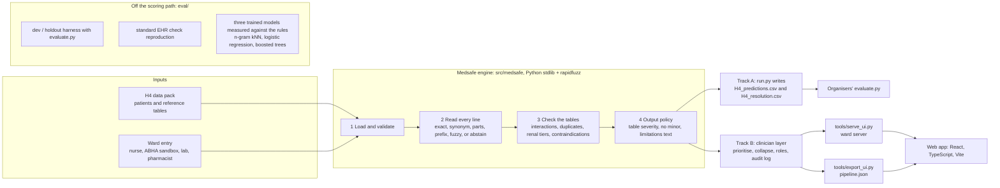

# Medsafe

**Medication safety, a second pair of eyes.**

A prescriber has about twenty seconds for a medication check. Medsafe reads the medicine list the way it is written on the slip, resolves messy brand and generic names, checks the list against interaction, renal, duplicate-therapy and pregnancy rules, re-scores every flag for the patient in front of you, and collapses clusters of alerts into the one change that clears them.

Alert fatigue is the problem it targets. A screen with three alerts and a clear action beats a screen with eleven and a scroll bar.

## The idea in one click

One switch on every patient: **Standard EHR check** or **Medsafe**. The same list, the same reference tables, two screens.

| | Standard EHR check | Medsafe |
|---|---|---|
| Names | Exact formulary match; misspellings and combination brands left out, unchecked | Every line resolved, combinations expanded, unresolvable lines marked "verify manually" |
| Alerts | Every listed pair at the reference severity, plus one flat renal warning per drug | Prioritised actions, the drug to review first, minor issues shown last |
| eGFR | Never read | Shown with the renal tier the rules applied |

The standard check is a reproduction built from the pack's tables (`tools/ehr_reference.py`), not a vendor product. `docs/ui-demo.md` says exactly what it does and why that is fair.

## Live demo

**https://pavansuryachintada.github.io/h4-hosp-patient/**

Sign in with any demo account below; clicking an account on the sign-in page signs you in directly. Add `?demo=1` to any page to pin the five demo patients under the top bar.

| Role | Email | Password | On the ward |
|---|---|---|---|
| Ward nurse | `nurse@medsafe.demo` | `Nurse@2026` | Admits a patient and types the medication list exactly as written |
| Lab technician | `lab@medsafe.demo` | `Lab@2026` | Enters eGFR; the kidney-dose rules re-run on it |
| Consultant physician | `prescriber@medsafe.demo` | `Medsafe@2026` | Accepts, overrides (with a reason) or defers each alert |
| Clinical pharmacist | `pharmacist@medsafe.demo` | `Pharma@2026` | Confirms names the system would not guess; answers deferred alerts |
| Reviewer | `reviewer@medsafe.demo` | `Review@2026` | Read-only |

These are hardcoded demo accounts with no real authentication. Who may enter what and do what is `src/medsafe/workflow.py` (`ENTRIES`, `PERMISSIONS`), enforced by the ward server; the UI only hides what a role cannot do.

### Running the ward demo end to end

The ward runs the real pipeline on every patient typed in, so it needs its local server. On the demo laptop, double-click **`demo.cmd`** (Windows) or run **`./demo.sh`** (macOS, Linux): it builds the app, starts the ward on an empty record store (earlier records move to `data/ward/archive/`, nothing is deleted) and opens the sign-in page. `demo.cmd --keep` carries on with the ward as it was.

1. **Ward nurse**: admit a patient. Fetch records through the ABHA sandbox (request consent, approve on the patient's phone, fetch) or start from a training-set patient.
2. **Lab technician**: enter eGFR. The kidney-dose rules re-run; a toast says which alerts changed.
3. **Pharmacist**: confirm any line the system would not guess.
4. **Prescriber**: accept, override (a reason is required) or defer each alert.
5. **Pharmacist**: answer what was deferred. Then open *Override patterns*.

Nothing needs typing: every field has two one-click examples (two demo patients for the admission form, eGFR 28 and 80, the two closest names for a line the system would not read, two override reasons, two review notes). They go through the same server and pipeline as anything typed. Switch role from the top bar without signing out; the bell lists each role's tasks, new tasks pop up as other roles create them, and the *Demo guide* drawer ticks the steps off as they happen. Colour means the state of the work everywhere: blue is your turn, amber is waiting on someone (or overridden), purple is with the pharmacist, green is done, and red is kept for serious alerts in the data. A contraindicated combination nobody has decided on opens one hard-stop dialog for the prescriber; nothing else interrupts.

The hosted site has no ward server: the ward pages say how to start one, and the training-set patients work as they are, with decisions kept in the browser.

## Screens

Every figure on every screen is read from `ui/public/data/pipeline.json`, which `tools/export_ui.py` writes from pipeline output. The UI holds no detection logic. Panels whose pipeline stage is not built say "not built yet", never "no issue found".

| Route | What it shows |
|---|---|
| `/login` | Sign-in with the demo accounts listed underneath |
| `/app` | The 1,500 training patients; `?demo=1` adds the pinned demo patients |
| `/app/patient/:id` | The EHR / Medsafe switch, a comparison strip, medicines as written → resolved, and the trust panel with the pharmacist handoff. `?mode=ehr` opens the EHR screen |
| `/app/why` | Four ways a standard check fails, each on one real training patient |
| `/app/intake` | Paste a list; a list the pipeline has seen opens its result. The ABHA tab explains consent-based sync |
| `/app/resolution` | Every line in the cohort, what it resolved to, confidence, method, and the training label |
| `/app/evaluation` | The latest `eval/reports/` run, scored by `evaluate.py`, next to the reference submissions and the trained-model challenger, misses included |
| `/app/ward` | Patients admitted on the ward, with the pharmacist and lab queues (needs the ward server) |
| `/app/ward/new` | The nurse's admission form, with the ABHA step: request consent, the patient approves, the records prefill the form (a simulated sandbox: `@sbx` addresses, synthetic patients, no ABDM connection) |
| `/app/ward/:id` | A ward patient: the role's own panel (eGFR, name confirmation, list edits), the same two-check screen, and a decision on every alert |
| `/app/ward/patterns` | Which alerts the ward overrides most, and why, from the audit log |

## How it works



No language model anywhere, no network at runtime: the same input gives the same output on every run. The graphs of the trained models are in `docs/figures/` (`python -m eval.ml_challenger`, then `python -m eval.ml_plots`).


1. **Resolve names.** Raw slip text such as `"Warf 5"`, `"crocine"` or `"PAN-D"` maps to a generic with a confidence. When the top two candidates are too close, the system abstains and asks for a manual check instead of guessing.
2. **Check rules.** Interaction pairs (class-level rules such as NSAID + ACE inhibitor), duplicate therapy (including the same drug under two brands), renal dose against eGFR, and pregnancy contraindications.
3. **Severity from the table, tier from the patient.** Every alert carries the reference table's severity and action, word for word. Renal rules are tiered by eGFR and the most restrictive tier that applies sets the severity: the same metformin line is major at eGFR 28 and raises nothing at eGFR 79.
4. **Prioritise and collapse, for the clinician.** Alerts are ordered by severity. When one drug sits in two or more serious interactions, the clinician view leads with "review that drug first". Minor issues are shown last and left out of the predictions file.

Every suggested action comes from the rule tables, not from a model.

No model is trained into the pipeline. `python -m eval.ml_challenger` trains three on the dev split, each in the standard library, and scores each against the rules on holdout with `evaluate.py`: a drug-name matcher (character n-gram TF-IDF, nearest neighbour), a reader of conditions and negation (logistic regression), and alert triage (gradient-boosted trees). The results, and why the submission stays rules only, are in `docs/ml-challenger.md`.

## Running it

The demo UI lives in `ui/` and reads one data file written from pipeline output. Regenerate it after any pipeline change:

```bash
python tools/export_ui.py   # -> ui/public/data/pipeline.json
cd ui
npm install
npm run build               # type-check and production build
cd ..
python tools/serve_ui.py    # http://127.0.0.1:8765: the app, plus the ward server
```

`tools/serve_ui.py` runs the real pipeline on each patient entered on the ward and keeps records and an append-only audit log in `data/ward/` (ignored by git). For UI work, `npm run dev` (http://localhost:5173) forwards `/api` to it. Nothing reaches the network; the server listens on localhost only.

## Deploying

**GitHub Pages (live now).** `.github/workflows/pages.yml` builds on every push to `main` with `BASE_PATH=/h4-hosp-patient/` and copies `index.html` to `404.html`, so deep links work on Pages.

**Vercel.** Import the repo, set the project's Root Directory to `ui`, deploy. `ui/vercel.json` pins the build (`npm ci`, `npm run build`, output `dist`) and rewrites every path to `index.html`, so deep links such as `/app/patient/H4P-AYE5BBKT` survive a refresh. Vercel serves from the root, so no base path is needed.

```bash
cd ui
npx vercel          # preview
npx vercel --prod   # production
```

## Project layout

```
tools/
  export_ui.py      pipeline output -> ui/public/data/pipeline.json (the UI's training-data input)
  serve_ui.py       the ward server: real pipeline on hand-entered patients, workflow policy, audit log
  ehr_reference.py  the standard EHR check the demo compares against
eval/
  ml_challenger.py  a trained name-resolution model scored against the rules (off the scoring path)
ui/
  public/data/      pipeline.json, generated; never edited by hand
  src/data/         contract.ts (the file's schema), loader, display formats, handoff log
  src/components/   shell, EHR screen, medication panel, trust panel, tier ladder
  src/screens/      sign-in, queue, patient, why, intake, resolution, evaluation, ward
  src/auth.tsx      hardcoded demo accounts and the protected-route guard
docs/round1-specs/  Round 1 technical requirements and design specifications
docs/phases/        Round 2 build plan, one document per phase
```

## What is real and what is not

- **Real:** the pipeline's name resolution, shown line by line in the app, and the evaluation numbers from the organisers' scorer. The standard EHR check is a real reproduction run over the same tables.
- **Simulated:** all patients and medicine lists (the synthetic H4 pack). No real patient data was used.
- **Not built yet:** rules, context severity, collapse and the alert budget. The app shows those panels as not built rather than inventing them.
- **Reduced:** the pack's tables are simplified subsets (496 generics, 2,196 interaction pairs, 169 renal tiers), authoritative for this exercise and not a clinical reference.

## Safety framing

- The app never describes a patient as safe. When nothing is flagged it says no issue was found in what was seen.
- A medicine name it cannot resolve is shown as unresolved and marked as not checked.
- A persistent trust panel on every patient says what was checked and what was not, that the list may be incomplete and that a clinician decides, and records a handoff for pharmacist review.

## Design

IBM Plex Sans and Plex Mono, tabular numerals, zero border radius, no gradients or shadows on cards. The only saturated colours are status colours, and every status is a bar, a square and a word, so it still reads without colour. Charts are hand-written SVG, with no chart library.
