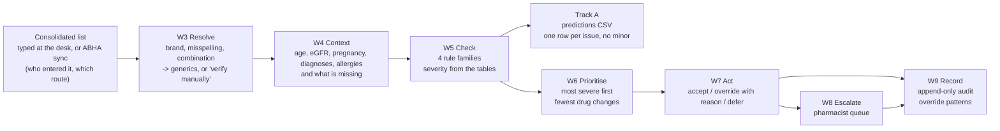

# The workflow

A patient at a district hospital takes medicines from up to three doctors. Nobody holds the full list, so a nurse copies everything the patient brings (slips, strips, bottles) into one consolidated list. Medsafe reads that list the way it is written, finds the safety risks, and puts them in front of a clinician who decides.

**Two tracks, one engine.**

- **Track B, point of care, is the workflow.** One patient at a time, as a clinician uses it: nine steps, below.
- **Track A, batch evaluation mode.** The same engine run over every test patient, writing `submission/H4_predictions.csv` and `H4_resolution.csv` for the organisers' scorer (`python run.py --split test --out submission`).

Nothing that is only for the clinician (prioritising, collapsing, acting, escalating, auditing) can change Track A's files; `tests/test_compliance.py` checks they are byte-identical with that layer present or absent.

## The nine steps (Track B)

| Step | What happens | Where |
|---|---|---|
| W1 Identify | Patient chosen by id or from the clinic queue. The reviewer's role (prescriber, pharmacist, nurse) decides what they may do in W7 | portal (ui/) |
| W2 Capture | The consolidated list arrives typed at the desk or by ABHA-style sync; both give the same messy list. The route and who entered it are recorded. No ABHA integration is built (docs/SCOPE.md) | portal |
| W3 Resolve | Every line to its generic(s), combination brands expanded, abstentions shown as "verify manually". No line is ever dropped | `medsafe/resolve/` |
| W4 Context | Age, weight, eGFR, pregnancy, diagnoses, allergies, and what is missing said out loud: "eGFR not recorded: renal checks not verifiable" | `medsafe/explain/limitations.py` |
| W5 Check | Interaction, duplicate therapy, renal dose, contraindication. Severity and action from the reference tables, word for word | `medsafe/rules/` |
| W6 Prioritise | Most severe first; then the fewest drugs whose review clears the most serious interactions | `medsafe/explain/prioritise.py` |
| W7 Act | Per alert: accept, override (a reason is required), or defer. Nothing is applied automatically | `medsafe/workflow.py`, portal |
| W8 Escalate | "Send to pharmacist review" creates a queue item with the patient, the alerts and any override reasons | portal |
| W9 Record | Every alert shown and every decision, with reason, user, role and time, in an append-only log; then which rules are overridden most, and why | `medsafe/workflow.py`, portal |

## A typical district-hospital check, and ours

| | Typical clinical-decision-support check | Medsafe |
|---|---|---|
| What it sees | Prescriptions written in this clinic's system | The consolidated list from every prescriber, as the nurse wrote it |
| Names | Exact formulary lookup; a misspelt or abbreviated brand is not recognised and silently unchecked | Fuzzy, abbreviation- and combination-aware resolution; unsure lines say "verify manually" |
| Combination brands | The brand is one product; the generics inside it are not checked | Expanded into each generic before any check |
| Severity | One flat warning per renal drug, whatever the eGFR | The tier the patient's eGFR falls under; no eGFR, no renal claim, and that is said |
| Volume | Every pair, every minor note, as separate popups | Minor issues shown last and never interrupting; serious interactions grouped by the drug to review first |
| What happens next | Click past | Accept, override with a reason, defer, or escalate; every decision recorded and reviewed for patterns |

## The four failure modes, each with a real case

Every case is a training patient, found by `python tools/workflow_examples.py`.

1. **Walled garden.** A clinic's system sees only its own prescriptions. In the training data 541 of 1,500 patients have three prescribers (`prescriber_count`), and 325 of those have at least one serious alert. Patient `H4P-01PBB8BM` is on gliclazide and glimepiride, two sulfonylureas: a major duplicate and a hypoglycaemia risk. The data records how many prescribers wrote a list, not which prescriber wrote which line, so the portal shows the count and marks three-prescriber patients; it never invents an attribution.
2. **Brand chaos.** `C. Lyrca 150 at bedtime` is Lyrica, pregabalin, and patient `H4P-08G5EJAP`'s kidneys put it at a major renal risk. An exact lookup does not recognise "Lyrca", so the risk is silently missed: the pack's exact-match baseline catches 0 of the 90 seeded near-misses. Medsafe catches all 90.
3. **Hidden combination generic.** Patient `H4P-1J7YM4RX` takes `Tab ULTRRACIT tds` (Ultracet: tramadol plus paracetamol) and `Tab parecetemol PRN`. That is paracetamol from two products, a major overdose risk invisible to any check that treats the brand as one product.
4. **Flat severity and pairwise popups.** Metformin's risk depends on the kidneys: no issue at eGFR 45 (`H4P-TPXGA1OD`), moderate at 30 (`H4P-4V9RTKE8`), major at 7 (`H4P-73IUT7SK`). A flat warning says the same thing to all three. And patient `H4P-KJRKSVWM` has 26 interacting pairs; shown as 26 popups, the 2 contraindicated ones are lost among them. Medsafe ranks them, keeps the minor one out of the way, and says "Review acenocoumarol and sildenafil and warfarin first: involved in 8 of the 11 serious interactions".

## Why minor alerts never interrupt

Minor alerts drive alert fatigue, fatigue drives dismissal, and dismissal buries the serious alert behind them. So a minor issue is shown, ranked last, and never submitted as an alert. The organisers' scorer penalises minor alerts because this is what happens in hospitals; leaving them out measured +0.0518 for a perfect detector (docs/DECISIONS.md D-018).

## What every alert says

The table's suggested action, word for word, and a confidence-and-limitations line: how surely the drug names were read, which rule fired, what could not be checked for this patient (an unresolved line, a missing eGFR, no allergy history), that the list may be incomplete, and that a clinician decides. A patient with no alert is never called safe: "No issue was found in the N medicines listed. The list may be incomplete."
